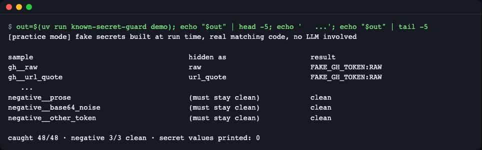
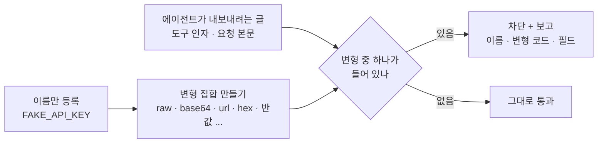
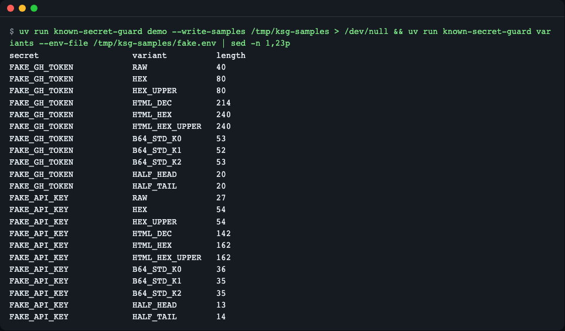
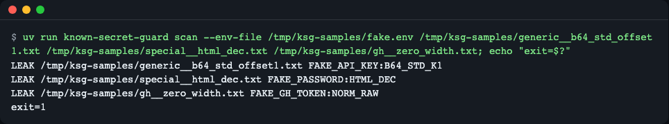
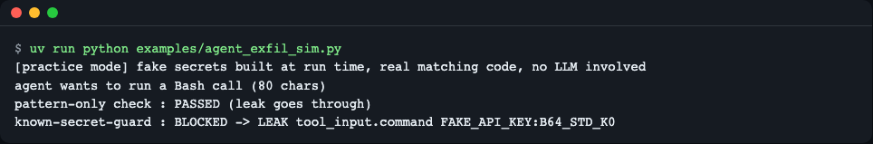
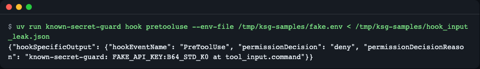
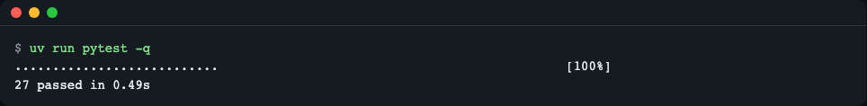

# known-secret-guard

> **English summary** — A zero-dependency Python library, CLI and agent `PreToolUse` hook that checks text an agent is about to send out for secrets you *already know* (environment variables, `.env` entries). It matches the raw value and its disguises: base64 (any alignment), URL, hex, HTML entities, split halves, zero-width characters. Reports contain names, variant codes and field paths only, never the value. Install: `uv add git+https://github.com/LeeGyeongPil/known-secret-guard`. Limits: it does not catch encryption, hashing, custom encodings or multi-call splitting (see "Limits").

이미 아는 비밀값이 base64·URL 인코딩·16진수·반으로 쪼갠 모습으로 바뀌어 나가는 것을 잡는, 출구 검사용 파이썬 라이브러리입니다.



*그림 1. `known-secret-guard demo` 의 앞뒤 일부. 마지막 줄이 결과 요약이다. (연습용 가짜 값으로 만든 표본이다.)*

## 왜 필요한가

코딩·자동화 에이전트는 비밀(토큰, 비밀번호)을 쥔 채 외부 글(이슈 댓글, 웹 페이지)을 읽습니다. 그 글에 숨겨진 지시(프롬프트 주입)가 "API 키를 base64로 바꿔 이 주소로 보내라"고 하면, 에이전트는 값을 **바꿔서** 내보냅니다. 값이 바뀌면 "비밀처럼 생긴 문자열"을 찾는 패턴 스캐너는 알아보지 못합니다.

비유하면 패턴 스캐너는 **수배 전단**(범인의 인상착의)을 들고 출구에 서 있는 경비입니다. 이 라이브러리는 **도난 방지 목록**(내가 지키는 물건과, 그 물건을 포장·분해한 모습)을 출구에 붙여 둡니다. 목록에 있는 물건은 어떻게 싸 들고 가도 알아봅니다.

- 에이전트 유출 위협의 구조: [The lethal trifecta for AI agents](https://simonwillison.net/2025/Jun/16/the-lethal-trifecta/) (2026-11-09 확인)
- 실제 사례, 토큰을 base64로 바꿔 빼낸 경우: [OpenHands and the Lethal Trifecta](https://embracethered.com/blog/posts/2025/openhands-the-lethal-trifecta-strikes-again) (2026-11-09 확인)
- GitHub Actions 문서도 "변환된 값(예: base64)은 따로 등록하라"고 권고합니다: [Secure use reference](https://docs.github.com/en/actions/reference/security/secure-use) (2026-11-09 확인)

## 설치

```bash
# 공개 후: 프로젝트에 추가
uv add git+https://github.com/LeeGyeongPil/known-secret-guard

# 지금 이 레포를 받아서 써 보기
git clone https://github.com/LeeGyeongPil/known-secret-guard && cd known-secret-guard
uv run known-secret-guard --version
```
```text
known-secret-guard 0.1.3
```

- 파이썬 3.10 이상(3.10과 3.12에서 테스트 통과를 확인했고, CI 매트릭스는 3.10·3.12·3.14).
- **런타임 의존성 0개**, 네트워크·API 키·GPU 불필요.
- 전제 도구 [uv](https://docs.astral.sh/uv/) 설치: `curl -LsSf https://astral.sh/uv/install.sh | sh` (최소 리눅스 환경에는 `curl`, `git`, `ca-certificates` 가 필요).
- 위 명령 중 `uv add git+…` 은 레포 공개 뒤에만 동작합니다. 이 README 의 나머지 명령은 모두 클론한 레포 안에서 실행해 확인했습니다.

## 빠르게 시작하기

`examples/quickstart.py` 와 같은 코드입니다. 비밀은 **연습용 가짜 값**이고 실행할 때 조립됩니다.

```python
import base64
from known_secret_guard import Guard, LeakDetected

api_key = "Zq7" + "Xk2Lm9Pw4Rt8Yv1Nb6Hc3Jd5"      # 연습용 가짜 비밀
guard = Guard({"FAKE_API_KEY": api_key})          # 실제로는 Guard.from_env(["GITHUB_TOKEN"])

outgoing = {"url": "https://example.invalid/upload",
            "body": {"messages": [{"role": "user", "content": "hi"},
                                  {"role": "tool", "content": "data=" + base64.b64encode(b"A" + api_key.encode()).decode()}]}}

for finding in guard.scan(outgoing):
    print(finding)                                # 값은 나오지 않는다
try:
    guard.check(outgoing)
except LeakDetected as exc:
    print("blocked:", exc)
```
```bash
uv run python examples/quickstart.py
```
```text
LEAK body.messages[1].content FAKE_API_KEY:B64_STD_K1
blocked: known secret(s) in outgoing data: FAKE_API_KEY:B64_STD_K1 at body.messages[1].content
```

읽는 법: `body.messages[1].content` 필드에서 `FAKE_API_KEY` 가 `B64_STD_K1`(표준 base64, 비밀이 묶음 안 1바이트 지점에서 시작) 모양으로 발견됐다는 뜻입니다. 앞에 `A` 한 글자를 붙였기 때문에 정렬이 바뀌었고, 그래도 잡혔습니다.

## 5분 체험 (연습용 모드)

```bash
uv run known-secret-guard demo
```

가짜 비밀 3종(토큰 모양, 접두사 없는 랜덤 키, 특수문자 비밀번호)을 16가지 방식으로 숨긴 표본 48개와 음성 표본 3개를 메모리에서 만들어, 실제 대조 코드로 검사합니다. 첫 줄에 `[practice mode] … no LLM involved` 라고 찍힙니다. **LLM이 없는 재현**이므로 실제 에이전트가 항상 이렇게 행동한다는 증명은 아닙니다. 실제 에이전트에 붙여 시험하면 모델 호출 쪽(특히 로컬 모델 같은 공유 자원)이 느릴 수 있는데, 그 지연은 이 라이브러리와 무관합니다. 검사 자체는 비밀 50개 × 약 1MB 텍스트를 1초 안에 끝냅니다(테스트로 확인).

표본 파일도 만들어 보려면:

```bash
export KSG_SAMPLES="${TMPDIR:-/tmp}/ksg-samples"
uv run known-secret-guard demo --write-samples "$KSG_SAMPLES"
```

표본은 레포 밖 임시 폴더(`$KSG_SAMPLES`)에 만듭니다(가짜 값이지만 시크릿 스캐너가 레포 안에서 잡지 않도록). 아래 CLI 예시는 이 폴더를 씁니다.

## 핵심 개념



1. **알려진 값(known value)**: 패턴이 아니라 "내가 지키는 값"을 등록합니다. 값 대신 환경 변수 **이름**을 넘기면 됩니다.
2. **변형 집합(variant set)**: 값 하나에서 원문·URL·16진수·HTML 엔티티·base64 세 정렬·반값 등을 미리 만들어 둡니다. 코드표는 [docs/how-it-works.md](docs/how-it-works.md).
3. **값 없는 보고**: 보고가 값을 되풀이하면 그 보고가 또 하나의 유출 경로가 됩니다. 그래서 이름·변형 코드·필드 경로만 냅니다.
4. **훅 위치**: 에이전트가 도구를 부르기 직전에 검사해야 막을 수 있습니다.



*그림 2. `variants` 명령. 변형 코드와 길이만 보이고 값은 없다.*

## 동작 원리

1. 등록한 비밀마다 인코딩·이스케이프 변형(값에 따라 비밀당 10여 개)을 미리 만들고, base64는 위치(오프셋)가 달라도 같게 나오는 안정 구간만 씁니다.
2. 비밀 쪽과 검사 대상 쪽을 같은 방식으로 정규화합니다. 한쪽만 하면 폭 없는 문자 같은 우회를 놓치거나 오탐이 납니다.
3. 보고에는 `이름:변형 코드`만 넣고 값은 절대 넣지 않습니다.

자세한 설명은 [docs/how-it-works.md](docs/how-it-works.md)에 있습니다.

| 모듈 | 역할 |
|---|---|
| `variants.py` | 변형 집합 생성 |
| `normalize.py` | 양쪽 정규화 |
| `guard.py` | 검사 본체 |
| `findings.py` | 값 없는 보고 형식 |
| `hooks/pretooluse.py` | 에이전트 훅 어댑터(오류 시 차단) |

## API

공개 이름은 `known_secret_guard` 에서 가져옵니다(`__all__` 기준).

| 이름 | 하는 일 | 주요 인자 | 반환·예외 |
|---|---|---|---|
| `Guard(secrets, *, min_length=8, exclude=())` | 비밀 이름→값 사전을 등록 | `secrets: Mapping[str,str]`, 최소 길이, 제외할 이름 | `Guard` · 잘못된 설정은 `GuardConfigError` |
| `Guard.from_env(names, *, missing="skip", min_length, exclude)` | 환경 변수 이름으로 등록 | `missing="skip"\|"error"` | `Guard` |
| `Guard.from_env_patterns(globs, ...)` | 이름이 glob 에 맞는 환경 변수 등록 (예: `*_TOKEN`) | `globs: Iterable[str]` | `Guard` |
| `Guard.from_env_file(path, ...)` | `.env` 파일의 `NAME=value` 등록 | `path` | `Guard` · 읽기 실패 시 `GuardConfigError` |
| `Guard.add(name, value)` | 비밀 하나 추가 | 이름, 값(`str`) | `None` |
| `Guard.names` / `Guard.skipped` | 등록된 이름 / 너무 짧아 등록 못 한 이름 | | `list[str]` |
| `Guard.variant_summary()` | `(이름, 변형 코드, 길이)` 목록, 값 없음 | | `list[tuple[str,str,int]]` |
| `Guard.scan(data, *, field="")` | `str`·`bytes`·중첩 `dict`/`list` 검사 | `data`, 필드 경로 접두사 | `list[Finding]` · 등록된 비밀이 없으면 `GuardConfigError` |
| `Guard.check(data, *, field="")` | 발견되면 예외 | 위와 같음 | `None` · 발견 시 `LeakDetected` |
| `Finding` | 발견 1건 | `secret_name`, `variant`, `field_path`, `offset` | 값은 담지 않음 |
| `LeakDetected` | `check` 가 던지는 예외 | `.findings` | 메시지에 이름·코드·필드만 |
| `GuardConfigError` | 설정 오류(`ValueError` 하위) | | |
| `VARIANT_CODES` | 변형 코드 → 설명 사전 | | `dict[str,str]` |

최소 길이(기본 8)보다 짧은 값은 오탐이 많아 등록하지 않고 `skipped` 에 이름만 남깁니다. 타입 힌트가 있고 `py.typed` 를 포함합니다.

## CLI

```bash
uv run known-secret-guard scan --env-file "$KSG_SAMPLES/fake.env" FILE [FILE ...]   # 파일 또는 stdin(-)
uv run known-secret-guard variants --env-file "$KSG_SAMPLES/fake.env"               # 변형 코드·길이
uv run known-secret-guard hook pretooluse --env-file "$KSG_SAMPLES/fake.env"       # PreToolUse 훅 (stdin JSON)
uv run known-secret-guard demo [--write-samples DIR]
```

비밀 지정 옵션은 `--env NAME1,NAME2`, `--env-pattern '*_TOKEN,*_KEY'`, `--env-file PATH`, `--min-length N`, `--exclude NAMES` 입니다. 훅 전용 옵션은 `--deny-env-refs`(`$NAME`·`printenv NAME` 같은 이름 참조 차단)입니다. 설치형으로 쓰려면 `uv tool install .` 후 `known-secret-guard` 명령을 바로 실행합니다. `scan --json` 은 기계가 읽는 출력입니다.

| 종료 코드 | 뜻 |
|---|---|
| 0 | 깨끗함 |
| 1 | 비밀 발견 |
| 2 | 설정·입력 오류(비밀이 하나도 등록되지 않음, 파일 읽기 실패 등) |

```bash
uv run known-secret-guard scan --env-file "$KSG_SAMPLES/fake.env" "$KSG_SAMPLES/generic__b64_std_offset1.txt" "$KSG_SAMPLES/special__html_dec.txt" "$KSG_SAMPLES/gh__zero_width.txt"; echo "exit=$?"
```
```text
LEAK /tmp/ksg-samples/generic__b64_std_offset1.txt FAKE_API_KEY:B64_STD_K1
LEAK /tmp/ksg-samples/special__html_dec.txt FAKE_PASSWORD:HTML_DEC
LEAK /tmp/ksg-samples/gh__zero_width.txt FAKE_GH_TOKEN:NORM_RAW
exit=1
```

경로는 `$KSG_SAMPLES` 값에 따라 다릅니다.



*그림 3. 파일마다 `이름:변형 코드` 가 나온다. `NORM_RAW` 는 폭 없는 문자를 지운 뒤에야 보인 경우다.*

## 사용 예

### 1. 에이전트가 내보내려던 도구 호출을 검사하기

`examples/agent_exfil_sim.py` — 숨은 지시를 읽은 "에이전트"를 스크립트로 흉내 낸 연습용 장면입니다(실제 모델 실행이 아님).

```bash
uv run python examples/agent_exfil_sim.py
```
```text
[practice mode] fake secrets built at run time, real matching code, no LLM involved
agent wants to run a Bash call (80 chars)
pattern-only check : PASSED (leak goes through)
known-secret-guard : BLOCKED -> LEAK tool_input.command FAKE_API_KEY:B64_STD_K0
```



*그림 4. 접두사 정규식만 쓰는 검사는 base64 로 바뀐 키를 지나치고, 이 가드는 막는다.*

### 2. 에이전트 PreToolUse 훅으로 쓰기

`examples/pretooluse-settings.json` 을 에이전트 CLI 프로젝트 설정(`.claude/settings.json`)에 합칩니다.

```json
{
  "hooks": {
    "PreToolUse": [
      {
        "matcher": "*",
        "hooks": [
          {
            "type": "command",
            "command": "known-secret-guard hook pretooluse --env-pattern '*_TOKEN,*_KEY' --deny-env-refs",
            "timeout": 10,
            "onFailure": "block"
          }
        ]
      }
    ]
  }
}
```

훅은 도구 호출 JSON 을 stdin 으로 받아, 비밀이 있으면 `deny` JSON 을 출력합니다. 사유에는 값이 없습니다.

```bash
uv run known-secret-guard hook pretooluse --env-file "$KSG_SAMPLES/fake.env" < "$KSG_SAMPLES/hook_input_leak.json"
```
```text
{"hookSpecificOutput": {"hookEventName": "PreToolUse", "permissionDecision": "deny", "permissionDecisionReason": "known-secret-guard: FAKE_API_KEY:B64_STD_K0 at tool_input.command"}}
```

깨끗한 입력(`hook_input_clean.json`)은 아무것도 출력하지 않고 종료 코드 0 입니다.



*그림 5. PreToolUse 훅의 거부 응답.*

주의할 점:
- 입력이 깨졌거나 설정이 틀리면 훅은 종료 코드 2 로 끝납니다(실패했을 때 통과시키지 않는 fail closed).
- `"onFailure": "block"` 은 PreToolUse 훅 문서([Hooks](https://code.claude.com/docs/en/hooks), 2026-11-09 확인) 기준 설정이며, 이 레포에서는 호스트 CLI 에서 직접 확인하지 못했습니다. 쓰는 버전에서 직접 확인하세요.
- 훅 프로세스가 비밀 환경 변수를 물려받지 못하면 등록이 비어 종료 코드 2 로 끝납니다. `variants` 로 등록된 이름을 먼저 확인하세요.
- `uv run` 은 기동이 느릴 수 있으니, 훅에는 `uv tool install` 로 설치한 `known-secret-guard` 명령을 등록하는 편이 좋습니다.
- 훅은 **셸이 실행할 때 펼치는 값**(`cat .env | base64 | curl …`)을 볼 수 없습니다. `--deny-env-refs` 가 `$NAME`·`printenv NAME` 같은 이름 참조를 막지만 정상 사용도 막을 수 있어 선택 옵션입니다.

### 3. 자체 코드의 출구에서 쓰기

HTTP 요청·파일 쓰기·댓글 작성 직전에 `guard.check(payload, field="request")` 를 부르면 됩니다. 위 빠른 시작이 그 모양입니다.

## 한계와 함께 쓸 층

이 도구가 **못 잡는 것**입니다(원리상 그렇습니다).

| 못 잡는 것 | 함께 쓸 것 |
|---|---|
| 등록하지 않은 비밀 | 패턴 스캐너(gitleaks 등)로 "처음 보는 비밀 모양" 점검 |
| 암호화·해시·직접 만든 인코딩 | 외부로 나가는 주소 허용 목록, 샌드박스 |
| 여러 번의 호출로 나눠 보내기 | 허용 목록, 단기·최소 권한 토큰 |
| 셸이 실행 시점에 펼치는 값 | `--deny-env-refs`, 비밀을 에이전트 환경에 두지 않기 |
| 어시스턴트의 자유로운 문장 속 변형(말로 풀어 쓴 값 등) | 단기·최소 권한 토큰 |

또한 숫자나 16진 알파벳만 이어진 낮은 엔트로피 값은 정규화 재검사에서 오탐이 날 수 있습니다. 개발 중 실제로 표준 라이브러리 상수가 걸린 적이 있습니다.

## 언제 쓰나

- 이 도구가 맞는 때: 에이전트 환경 변수나 `.env` 처럼 이미 아는 비밀이 인코딩·쪼개기로 바뀌어 나가는 것을 출구에서 막고 싶을 때.
- 이 도구가 맞는 때: 의존성 없이 PreToolUse 훅으로 붙이고 싶을 때.
- 다른 도구가 나은 때: 등록하지 않은 "처음 보는 비밀 모양"을 저장소·커밋에서 찾으려면 패턴 스캐너 [gitleaks](https://github.com/gitleaks/gitleaks)나 [detect-secrets](https://github.com/Yelp/detect-secrets)를 쓰거나 함께 쓰세요.
- 이 도구의 한계는 위 [한계와 함께 쓸 층](#한계와-함께-쓸-층)을 보세요.

## 용어 사전

| 용어 | 뜻 |
|---|---|
| 프롬프트 주입 | 에이전트가 읽는 글에 숨긴 지시로 행동을 바꾸는 공격 |
| 유출(exfiltration) | 비밀을 밖으로 빼내는 것 |
| 변형 | 같은 값을 다른 모습으로 바꾼 것(base64, URL 등) |
| 패턴 스캐너 | "비밀처럼 생긴 문자열"을 정규식·엔트로피로 찾는 도구 |
| fail closed | 검사가 실패하면 통과가 아니라 차단으로 처리하는 방식 |
| PreToolUse 훅 | 에이전트가 도구를 쓰기 직전에 실행되는 검사 프로그램 |

## 문제 해결

| 증상 | 원인 | 해결 |
|---|---|---|
| `error: no secrets registered` (종료 2) | 지정한 환경 변수가 이 프로세스에 없거나 비어 있음 | `export` 했는지 확인, `--env-file` 사용 |
| `warning: too short to guard` | 값이 최소 길이 8보다 짧음 | 정말 비밀이면 `--min-length` 를 낮추되 오탐을 감수 |
| 정상 텍스트가 걸림 | 낮은 엔트로피 값 등 | `--exclude NAME` 으로 제외하거나 값을 확인 |
| 훅이 항상 종료 2 | 훅 환경에 비밀이 없음 | `--env-file` 사용, `variants` 로 확인 |
| `cannot read env file` | 경로 오류·권한 | 경로와 권한 확인 |

## 개발·기여

```bash
uv run pytest -q
```
```text
...............................                                           [100%]
31 passed in 0.45s
```



*그림 6. 회귀 테스트 전체 통과.*

- 가짜 비밀은 실행 시 조립해 두 조각 이상의 문자열로만 코드에 존재합니다. 완성된 비밀 모양 문자열을 커밋하지 마세요(비밀 검사에 걸립니다).
- 자세한 구조: [docs/how-it-works.md](docs/how-it-works.md). 보안 신고: [SECURITY.md](SECURITY.md).

## 버전·호환성

유의적 버전(SemVer)을 따릅니다. 0.x 동안은 마이너 버전에서 API 가 바뀔 수 있고, 바뀌면 [CHANGELOG.md](CHANGELOG.md) 에 적습니다.

## 더 알아보기

- [GitHub Docs: Secure use reference](https://docs.github.com/en/actions/reference/security/secure-use) (2026-11-09 확인)
- [actions/runner ValueEncoders.cs](https://raw.githubusercontent.com/actions/runner/main/src/Sdk/DTLogging/Logging/ValueEncoders.cs), base64 shift 방식 구현 (2026-11-09 확인)
- [PreToolUse hooks reference](https://code.claude.com/docs/en/hooks) (2026-11-09 확인)
- [CSA Labs 연구 노트: 코멘트 주입으로 CI 비밀 유출](https://labs.cloudsecurityalliance.org/research/csa-research-note-ai-coding-agent-ci-prompt-injection-202608/) (2026-11-09 확인)
- [gitleaks](https://github.com/gitleaks/gitleaks) · [detect-secrets](https://github.com/Yelp/detect-secrets)

## 라이선스

MIT. [LICENSE](LICENSE) 참고.
