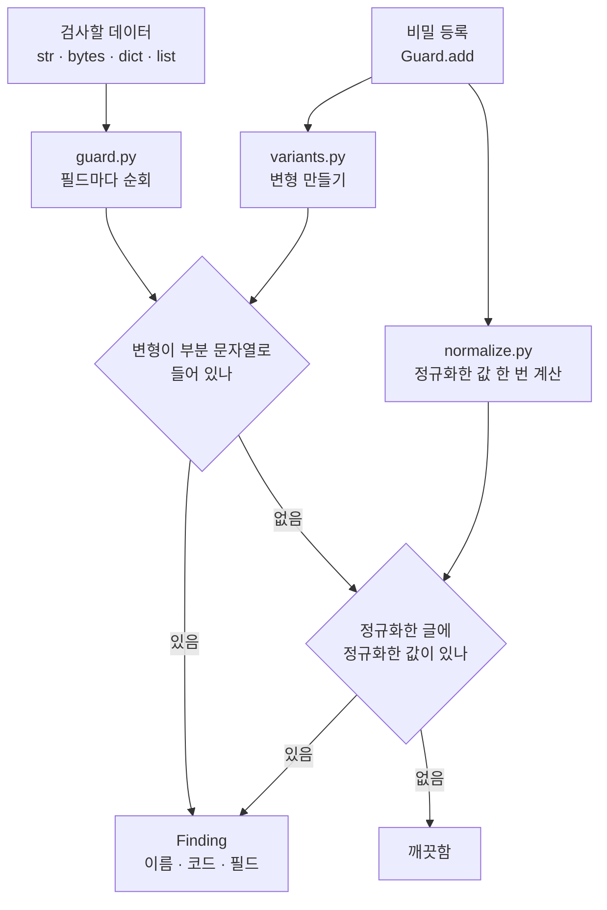
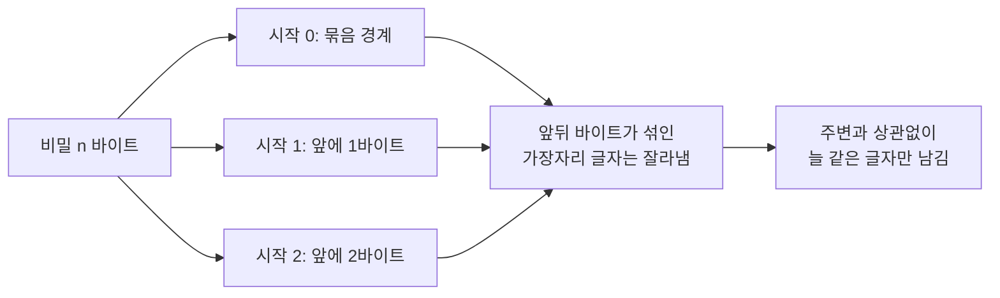

# 동작 원리 (How it works)

이 문서는 `known-secret-guard` 가 비밀의 변형을 어떻게 만들고 비교하는지 설명합니다. 코드는 `src/known_secret_guard/` 에 있습니다.

## 1. 전체 흐름

1. 등록할 때 비밀마다 변형 목록과 정규화한 값을 **한 번만** 만듭니다.
2. 검사할 때 `dict`·`list` 는 필드 경로(`body.messages[1].content`)를 붙여 가며 끝까지 내려가고, 문자열마다 변형이 들어 있는지 `in` 검색을 합니다.
3. 직접 변형이 걸리지 않았을 때만 글을 정규화해 한 번 더 봅니다.
4. 한 비밀·한 필드에는 발견을 하나만 보고합니다. 가장 직접적인 변형(원문 → 인코딩 → 반값 순서)이 우선입니다.

## 2. 변형 코드표

| 코드 | 모양 |
|---|---|
| `RAW` | 값 그대로 |
| `URL`, `URL_PLUS` | 퍼센트 인코딩, 폼 인코딩(공백이 `+`) |
| `JSON`, `REPR` | JSON·파이썬 repr 이스케이프 |
| `HEX`, `HEX_UPPER` | UTF-8 바이트의 16진수 |
| `HTML_DEC`, `HTML_HEX`, `HTML_HEX_UPPER` | `&#65;`, `&#x41;` 같은 HTML 엔티티 |
| `B64_STD_K0/K1/K2`, `B64_URL_K0/K1/K2` | base64(표준·URL-safe) 세 가지 정렬 |
| `HALF_HEAD`, `HALF_TAIL` | 값의 앞쪽 절반, 뒤쪽 절반(나눠 보내기) |
| `NORM_RAW`, `NORM_HALF_HEAD`, `NORM_HALF_TAIL` | 정규화 후에야 보이는 경우 |

값에 특수문자가 없으면 `URL` 이 `RAW` 와 같아져서 먼저 나온 코드(`RAW`)만 남습니다. 전체 목록과 설명은 `known_secret_guard.VARIANT_CODES` 에 있습니다.

## 3. base64 의 "안정 구간"

base64 는 3바이트를 4글자로 바꿉니다. 비밀이 3바이트 묶음의 어디서 시작하느냐(0, 1, 2번째 바이트)에 따라 같은 비밀도 다른 글자가 됩니다. 그리고 비밀 앞뒤에 무엇이 붙었는지에 따라 가장자리 글자가 바뀝니다.

`variants.b64_stable_segments` 는 정렬 `k` 마다 "더미 `k` 바이트 + 비밀"을 인코딩한 뒤, **비밀의 비트만으로 만들어진 글자 구간**만 남깁니다. 그래서 JSON 본문 중간 어디에 들어가 있어도 같은 부분 문자열로 찾을 수 있습니다. 표준과 URL-safe 각각 세 구간이라 base64 변형은 모두 6개입니다.

참고로 GitHub Actions 러너는 "값 그대로 + base64 두 가지 이동"을 가립니다([ValueEncoders.cs](https://raw.githubusercontent.com/actions/runner/main/src/Sdk/DTLogging/Logging/ValueEncoders.cs), 2026-11-09 확인). 이 프로젝트의 조사 단계 프로브에서 스트림 중간 페이로드 48개 중 16개만 맞았습니다.

## 4. 정규화는 반드시 양쪽에

폭 없는 문자(U+200B 등) 끼워 넣기, HTML 태그로 쪼개기, 엔티티·퍼센트 이스케이프를 되돌리려고 글을 정규화합니다(`normalize.py`): 이스케이프 해제(최대 3회) → 태그 제거 → 폭 없는 문자 제거 → 공백 제거 → 소문자화.

이것을 **글에만** 적용하면 안 됩니다. 비밀에 `+`, 공백, `%`, `&` 가 있으면 글 쪽은 `unquote_plus` 로 `+` 가 공백이 되었다가 지워지는데, 비밀 쪽은 그대로여서 맞지 않게 됩니다. 그래서 비밀도 같은 함수로 접어 둡니다. 조사 프로브에서 실제로 겪은 버그입니다.

## 5. 값 없는 보고

`findings.py` 는 비밀값·변형 문자열·주변 글을 받지 않습니다. `Finding` 은 이름·코드·필드 경로·오프셋만 담습니다. dict **키**에 비밀이 들어 있으면 경로에 키를 쓰지 않고 `<key#N>` 으로 보고합니다. 테스트 `tests/test_no_value_in_output.py` 가 모든 출력 경로에 값과 그 변형이 없음을 확인합니다.

## 6. 훅이 실패했을 때

`hooks/pretooluse.py` 는 입력 JSON 이 깨졌거나 비밀이 등록되지 않았을 때 종료 코드 2 로 끝납니다. 검사하지 못한 호출을 통과시키지 않기 위해서입니다.

## 7. 알려진 한계

- 변형은 미리 정한 목록이라 암호화·해시·직접 만든 인코딩은 찾지 못합니다.
- 반값(`HALF_*`)은 값이 최소 길이의 두 배 이상일 때만 만들어집니다.
- 낮은 엔트로피 값(숫자·16진 알파벳 연속)은 정규화 재검사에서 오탐이 날 수 있습니다. 개발 중 표준 라이브러리의 `'0123456789ABCDEFabcdef'` 상수가 걸린 적이 있습니다.
- 단순 부분 문자열 검색이라 비밀이 많고 글이 매우 크면 느려질 수 있습니다. 50개 × 약 1MB 는 1초 안에 끝나는 것을 테스트로 확인했습니다.
